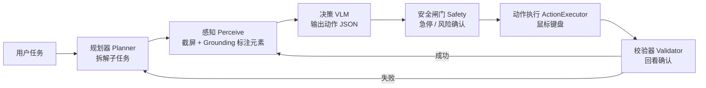

# LocalCUA · 本地电脑操作智能体

[](https://github.com/muye1122/LocalCUA/actions/workflows/ci.yml) [](LICENSE) [](pyproject.toml) [](#-30-秒看懂)

## ⏱ 30 秒看懂

> 这是一个**能在自己电脑上真正操作鼠标键盘的本地 Agent**：截屏 → 本机 8B 视觉模型看画面决定下一步 → 程序点鼠标敲键盘 → 再看新画面，循环到任务完成。全程 Ollama 本地推理、零联网、数据不出本机，在一张 8GB 显存的笔记本显卡上跑通。
>
> 它和聊天机器人的差别是**闭环操作真实 GUI**：打开 Dev-C++、敲代码、编译、运行、拿到 `5050`。难点不是「模型会不会答」，而是「每一步画面都可能变，点错了不可逆」。

**给老师 / 评审的阅读路线**：先看这一节 → [架构](#-架构) 与 [快速开始](#-快速开始) 了解链路；
再看 [技术复盘：真机踩坑链](#-技术复盘真机踩坑链)，那里是本项目真正的核心资产；
[安全机制](#-安全机制) 说明误操作如何被拦住。想动手跑，按 [常见问题](#-常见问题) 排查。


> **关于这份公开版**：这是一个「本地离线 GUI Agent」的**作品证据**，不是通用框架。
> 仓库不含任何真实联系人、运行截图、轨迹日志或个人数据（`data/`、`.venv/`、`.env` 均被忽略）；
> 文中所有会话名（`示例联系人A` / `示例联系人B`）都是占位示例，部署前请在 `config.yaml` 的
> `agent.wechat_allowed` 里改成你自己的白名单。模型全程在本机 Ollama 运行，不上传任何数据。

> 纯本地、免费、可扩展的 **Computer-Use Agent**。截屏 → 视觉语言模型（VLM）决策 → 自动操作鼠标键盘，循环执行你下达的电脑任务。全部离线运行，数据不出本机。

LocalCUA 的目标：在消费级显卡（如 RTX 5060）+ 本地 Ollama 上，跑一个**点得准、长得稳、可干预、可复盘**的 GUI 智能体，而不是只能猜坐标的玩具。

---

## ✨ 特性

- **本地免费**：默认对接本地 [Ollama](https://ollama.com) 视觉模型（如 `qwen3vl:8b`），零 API 费用、完全离线。也可一键切到任意 OpenAI 兼容后端。
- **精准点击（Grounding）**：默认用 **VLM 自检测**让模型自己框出可交互元素，Agent 点 `element_id` 而非猜坐标，点中率显著提升；还可切换到高精度的 [OmniParser](https://github.com/microsoft/OmniParser) 服务或 UI-TARS 系模型。
- **高 DPI 适配**：进程启动即声明 DPI 感知，在 125% / 150% 缩放的笔记本上，截图坐标与点击坐标自动对齐，规避 Windows CUA 最常见的「点偏」问题。
- **安全可控**：坐标越界自动夹紧；鼠标甩到屏幕左上角 `(0,0)` 急停；删除/发送/付款等**高风险操作弹窗人工确认**。
- **长任务不跑偏**：内置规划器把任务拆成子任务清单，支持失败重规划；可选校验器在每步后回看截图确认是否成功。
- **人在回路**：模型信息不足时会 `ask`，界面弹出回复框，你回完它接着干。
- **跨任务长期记忆**（`agent.long_memory`）：`data/long_memory.json` 只记两类事实——
  某个程序这次是怎么开起来的（窗口标题 / exe）、哪些做法试过没用。
  下次开机注入极短一段（≤120 字）给模型，任务结束时才落盘一次。
  它和任务内的 `history` / 草稿纸 / `_fail_log` 分工不同：后者只活在当前任务里，
  前者是跨开机的经验。实测模型从不填 `subtask_done`，那套分段机制已整体删除。
- **单标点不重敲**：真机「给一个「，」发出去是「，，」」的根因不是输入法，
  而是帧差在 2560×1600 上检不出单个逗号（约 100 像素），程序误判「没敲进去」又敲了一遍。
  现在用极低阈值 + 正文只敲一次，检不出就放弃发送；`_ImeGuard` 作为另一层保险保留。
- **动作后不秒截**：期待新画面的动作给渲染一个观察窗，帧差连续两帧不变就提前走
  （真机 1.1s / 3.0s）；「要不要看证据」由动作类型决定，**不交给模型预判**——
  真机里它自报的 `expect_change` 判错过，且差分只要 16ms，交给 8B 决策反而多花近 1 秒。
- **截图不堆积**：运行中滚动保留最近 50 张（超出删最旧），任务结束自动全删，只留体积很小的文字轨迹 JSONL。
- **三种入口**：桌面独立窗口（双击 bat）、浏览器 Web UI、终端 CLI，任选。
- **可选隔离**：一键生成 Windows Sandbox 配置，在隔离桌面里跑 Agent，碰不到真实数据。

---

## 🏗️ 架构



主循环（`agent/core.py`）：**感知 → 规划 → 决策 → 安全 → 执行 → 校验**，循环直到模型输出 `done` 或达到最大步数。

---

## 🚀 快速开始

### 1. 准备模型（本地，免费）

```bash
# 安装并启动 Ollama（https://ollama.com）
ollama pull qwen3vl:8b       # 任意支持图像的本地模型均可
```

### 2. 安装依赖

```bash
pip install -r requirements.txt
```

> 也可以把整个项目装成可复用的命令行工具（支持 `pipx install .` / `uvx`）：`pip install .`，之后直接敲 `localcua`（等价于 `python run.py`）。打包配置已显式声明 `agent` / `ui` 两个包与 `config.yaml`，不会出现 flat-layout 构建失败。

> 需要 Python 3.10+，且 **pyautogui 依赖图形环境**（Windows 原生最佳；macOS/Linux 需自行装好 scrot/Xvfb 等）。Windows 沙箱隔离见下文。

### 3. 启动（三选一）

**桌面独立窗口（双击即用，演示推荐）**

双击项目根目录的 `一键启动-桌面版.bat`，几秒后弹出一个**无地址栏、无标签栏的独立窗口**，
里面就是完整的 Web UI（任务输入 / 实时日志 / 思考栏 / 停止 / 高风险确认 / 回复框）。
关掉这个窗口 = 自动停服务；任务栏上那个最小化的黑色窗口是日志窗，别手关它。
日志写在 `data/desktop.log`，`python desktop.py --check` 可先做一次启动自检。

原理：本机两个 Python 都没有 tkinter，所以用 Edge/Chrome 的 `--app` 模式把现有网页
拉成独立窗口，复用全部现成功能、界面一行都不用重写。启动器带一个独立
`--user-data-dir`，否则 Edge 会把窗口交给已有浏览器进程，程序就感知不到「你关了窗口」。
找不到 Edge/Chrome 时会退回普通浏览器标签页，并在日志里写明。

**Web UI（浏览器打开）**

```bash
python run.py
# 浏览器打开 http://127.0.0.1:7860
```

**终端模式（无需浏览器）**

```bash
python run.py --cli
```

在输入框/终端写下任务，例如：

> 打开计算器，算 123 + 456，把结果记到记事本里

Agent 会自动截屏、思考、操作，并把每步日志实时显示出来。

---

## ⚙️ 配置（`config.yaml`）

所有字段都可用环境变量覆盖（前缀 `CU_`），便于不同机器/场景切换。

| 配置项 | 说明 | 环境变量 |
|---|---|---|
| `provider.type` | `ollama` 或 `openai`（兼容任何 OpenAI 格式后端） | `CU_PROVIDER` |
| `provider.ollama.model` | 本地视觉模型名 | `CU_MODEL` |
| `provider.openai.*` | 后端地址 / key / 模型 | `CU_OPENAI_KEY` |
| `agent.max_steps` | 单任务最大步数 | `CU_MAX_STEPS` |
| `agent.step_pause` | 每步前可干预停顿（秒） | `CU_PAUSE` |
| `agent.temperature` | 采样温度 | `CU_TEMP` |
| `agent.max_screenshots` | 运行中滚动保留的截图张数（超出删最旧，结束全删） | — |
| `agent.verify_screen_change` | 模型自称「无新内容」时仍用像素差兜底校验 | — |
| `grounding.backend` | `yolo_caption`(默认) / `vlm` / `none` / `omniparser` / `ui_tars` | — |
| `planner.enabled` | 是否启用任务拆解 | — |
| `validator.enabled` | 是否启用每步回看校验（更稳但更慢） | — |
| `safety.*` | 急停、越界夹紧、风险词确认 | — |
| `web.host` / `web.port` | Web 绑定地址与端口 | — |

---

## 🎯 关于精准点击（Grounding）

点不准是本地 7B 模型最大的痛点。实测结论：让 7B 直接猜坐标误差 **±30~90px**（两步局部放大也无改善），
让它「看图选编号」或「读清单选编号」都不稳定；但让它给元素裁小图**起名**很可靠。
所以默认方案把活儿拆给最擅长的角色：

**`yolo_caption`（默认，推荐）**
- **YOLO**（OmniParser `icon_detect` 的 ONNX 版，80MB，CPU 单帧 ~200ms）负责「哪里有可点元素」，bbox 精度 ±3px；
- **本地 7B** 只做定性判断：给元素起名、用 `element_desc` 说出要点什么（如「任务栏最左边的开始按钮」）；
- **程序**负责定量：bigram 文本匹配 + 位置启发（「任务栏」=底部、「最左」=x<6%）选出元素，点 bbox 中心，零幻觉。

模型动作写法：`{"action":"click","element_desc":"任务栏底部的搜索框","expect_change":true}`。

权重下载（国内直连，无需代理）：
```bash
curl -L -o models/icon_detect/model.onnx \
  "https://www.modelscope.cn/models/onnx-community/OmniParser-v2.0_icon_detect/resolve/master/onnx/model.onnx"
# 依赖只有 onnxruntime（不需要 torch）
pip install onnxruntime
```

1. **`vlm`**：复用主视觉模型自己框出可交互元素，零额外依赖但精度一般（7B 估坐标误差大）。
2. **`none`**：关闭检测，回到「像素 + 绝对坐标」行为，速度最快，适合简单界面。
3. **`ui_tars`**：使用 UI-TARS 系模型，直接输出 `0–1000` 归一化坐标再做检测（`grounding.ui_tars.factor` 可调，默认 1000），适合已部署 UI-TARS 的场景。
4. **`omniparser`**（高精度）：另起一个 OmniParser 服务，获得更准的图标/文字检测。启动方式：
   ```bash
   # 在 OmniParser 仓库按官方说明启动其 /parse 服务（默认 http://localhost:8000）
   # 然后把 config.yaml 改为：
   # grounding:
   #   backend: omniparser
   #   omniparser:
   #     server_url: http://localhost:8000
   ```

---

## 🖱️ 打开程序：能用系统 API 就不用模型


「打开 X」是最高频的动作，所以它完全不交给模型逐步决策，走固定顺序：

1. **已经在运行** → `EnumWindows` 找窗口直接聚焦（0 步）。
2. **桌面有图标** → `Win+D` 露桌面 → 双击图标 → 等窗口出现。桌面图标的名字和坐标直接
   读桌面那个 `SysListView32` 控件（`agent/desktop_icons.ps1`，实测 0.6 秒拿全、坐标 ±0px）。
   桌面上没有这个图标时**不会动用户的窗口**，直接往下走。
3. **开始菜单搜索** → 点开始按钮 → 敲程序名 → 回车（回车 = 打开最佳匹配，约 3 秒）。
4. **视觉兜底** → 前三条都失效时才让模型在截图里找。

> 为什么第 2 步重要：让视觉模型在桌面截图里找图标要逐个元素起名（一次一个模型调用），
> 十几个图标就是半分钟；而桌面本来就是一个标准 ListView，问 Windows 要清单是毫秒级且没有误差。

## 📥 下载更大的模型（国内源）

`ollama pull` 走官方 registry，本机实测只有 ~330KB/s（4.7GB 要 4 小时）。同一份 Qwen 官方 GGUF
在 ModelScope 走国内 CDN，4 连接约 2MB/s，**约 40 分钟**，且支持断点续传与 sha256 校验：

```bash
# 下 qwen2.5-coder:7b（写代码用的那个），下完自动导入 ollama
python tools/fetch_gguf.py --conns 4 --out D:/models --create qwen2.5-coder:7b

# 中断了重跑同一条命令即可续传；只校验已有文件：
python tools/fetch_gguf.py --check
```

---

## 🔗 一次看屏幕，连做几个动作

每一步都要「截图 → YOLO → OCR → 认名 → 视觉推理」，这一步成本 ~10 秒，其中 9 秒花在
**确认屏幕上有什么**，只有 1 秒在「想」。步数一多，总时间就被重复的看屏幕吃掉，
正确率也被决策点连乘拖垮（单点 90%，30 个决策点连乘只剩 4%）。

所以模型现在必须按固定格式回答，一次可以给**一串**不需要重新看屏幕的动作：

```json
{"plan":"调出地址栏输路径再回车",
 "actions":[{"action":"key","key":"ctrl+l"},
            {"action":"type","text":"D:\\测试"},
            {"action":"key","key":"enter"}]}
```

- `plan`：一句话说清判断和打算，显示在界面的思考栏，也进入下一步的记忆。
- `actions`：数组。下一步要点了才知道点哪 → 只给 1 个；不需要看屏幕 → 给 2~4 个。
- **硬约束**：数组里最多 1 个点击，且必须是第一个；点击之后只能跟 `type/key/wait/scroll`。
  第二个点击用的还是旧截图的坐标 —— 那正是「乱点」的来源，所以 `_plan_batch` 会直接截断它。
- 同一串动作连做 3 次仍无进展 → 判定卡死，一个都不执行，逼模型换工具级做法。

除了批处理，每轮还会把**已经失败过的做法**（点了没反应、目标找不到、同一区域点 3 次）
列进提示词。模型看不到自己失败过什么，就会一遍遍重试同一条死路。

> 实测：强制格式后 7B 的 `plan` 3/3 稳定输出，但 `actions` 只有 1/3 会真的给多个动作。
> 机制已经就位，换成会思考的模型（qwen3-vl:8b）才能兑现「步数砍到个位数」。

### 步数不是靠模型砍下来的，是靠「工具」

真机跑「打开浏览器搜索今天的天气」：**8 步 138 秒，任务还没完成**。它不叫 `open_app`，
而是去任务栏图标上连点两次，再在页面上乱点，最后也没输出 `done`。

同一句话现在的做法是给它一个**工具级动作**，程序按真人的四步执行
（打开浏览器 → `ctrl+L` 聚焦地址栏 → 逐字输入 → 回车），界面上的动作一样看得见，
但链路是确定的：

| 任务 | 改之前 | 改之后 |
|---|---|---|
| 打开浏览器搜索今天的天气 | 8 步 / 138s / **未完成** | **1 步 / 9s / 完成**（窗口标题确认变成「今天的天气 - 搜索」） |
| 打开 D:\测试，新建文件夹「报告」 | 几十步 / 259s / 失败 | **1 步 / 7s / 完成**（文件夹真实存在） |
| 打开 Dev-C++ 写代码 | ~176s | 1 步 / 45s |

模式是固定的，它对任何没见过的任务都成立：**凡是可以拆成「固定动作链」的目标，
就给它一个工具，模型只负责选工具和填参数。** 模型越是不知道怎么做，越需要工具，
而不是更多自由度。

### 一步 66 秒变 18 秒：`[定位]` 曾经在偷偷调 12 次模型

真机日志里一步 66~124 秒，而「截图+检测+OCR+推理」只占 19 秒。差额全在 `[定位]`：
模型说"点任务栏的微信图标"，程序要把自然语言变成坐标，于是 **对候选元素逐个调一次模型起名**，
12 个候选 = 12 次调用 = 40~90 秒。

三处修法：

- 批量起名（一步只调 1 次）与逐个起名**共用同一张表**：批量已经问过的，不再单独问。
- 没名字的元素超过 8 个就放弃逐个补问，改用位置分。
- 新增实测探针 `tools/try_locate.py`（不碰鼠标）：定位从 **16.2s/次 → 0.0s/次**。

同时给定位加了「位置对、东西错」的硬校验：目标里的实词（`任务栏最右侧的微信图标` → `微信`）
必须出现在元素名字里，否则**宁可不点**。真机出现过靠位置分 1.15 把电池图标当成微信图标、
日志还写着"定位成功"的情况。

---

## 🛡️ 安全机制

- **坐标夹紧**：任何越界坐标都会被夹回屏幕内，绝不点飞。
- **急停**：把鼠标甩到屏幕左上角 `(0,0)` 立即中止（pyautogui FAILSAFE）。
- **高风险确认**：命中 `safety.risk_keywords`（删除/发送/付款/格式化…）的操作，Web 弹窗或终端询问，你允许才执行。
- **测试护栏 `--no-send`**（`agent.no_send`，默认关）：验证任务时绝不对外发消息。
  拦的是执行器最底层——`send_message` 模板、模型直接发的动作、以及微信/QQ/WorkBuddy
  等对话窗口里的回车；被拦的动作视为执行成功，链路照常走完，方便验证流程而不打扰真人。
  `python tools/run_task.py --task "给示例联系人A发消息说你好" --no-send`、
  配置 `no_send: true`、或环境变量 `CU_NO_SEND=1` 都能开。
  真机：一条带发送的任务被拦成 `0.0s DONE`，微信没打开、消息没发出。
  注意浏览器地址栏和开始菜单的回车不受影响，搜索/开程序照样能测。
- **微信发送白名单**：`agent.wechat_allowed`（默认只有「文件传输助手」和「示例联系人A」）。三道闸同时生效：
  路由层先拦（整条任务直接拒绝、一步都不跑）→ 模板层再校验（防模型绕过路由发 `send_message`）→
  打字闸兜底（前台是微信窗口时，非白名单任务一律不许打字）。误发给真人不可撤销，所以是"默认拒绝"。
- **打字闸**（`agent.type_guard`）：绝不把字打进你已打开的文件（真机改坏过 `models_fetch.log`）；
  记事本开着文件时先 Ctrl+N 开空白页；同一句话敲第二遍会先 OCR 确认——已在屏上就直接判定任务完成。
- **对话框清障**（`agent.dialog_guard`）：残留的「另存为」挡在屏幕上时先按 Esc（真机：模型对着
  对话框连发 3 步 open_app，一事无成）。
- **前台守卫**：动作前发现前台被别的程序抢走会抢回来；抢不回就主动让路——你在用电脑时它不会跟你抢鼠标。
- **「青蛙眼」帧差**（`agent.frog_eye`）：每步先跟上一帧做差分（半分辨率 numpy，约 16ms），
  只在**变化区像个弹窗**时才启用裁剪（`frog_eye_model: popup`，默认）——点「另存为」/「删除」
  蹦出对话框那一刻，弹窗外的网页一个字都不用重读（实测 OCR 2.4s → 0.4s）。切到这一步时：
  ① 两帧实质没动（只有光标闪烁级噪声）→ 整条视觉流水线（YOLO/OCR/认名）全部跳过；
  ② 变化区是 1~3 块边界清楚的矩形、占屏 1%~42%、不是整条横带/竖带 → 判为弹窗，只读那一块，
     不变区域的元素连名字带坐标复用上一帧；
  ③ 翻页/滚动/整页跳转（大片或贴边变化）→ 老实跑全屏，不硬裁；
  ④ 给模型的图始终是全屏（方位感不能丢），变化区用红框框出来引导注意力。
  `frog_eye_model: outline` 可以回到"每步都裁"的旧行为。
  动态壁纸会让 ①② 永远失效（整屏都在变），想吃到这个加速请用静态壁纸。
- **进场确认**（`agent.entry_confirm`，青蛙眼的另一个用法）：双击 / `open_app` 之后，系统自己
  判断「是不是真的进了一个新窗口」——帧差分看画面变了多少，Win32 读前台标题和 exe 确认进去的是谁，
  两条都成立就把「你已经在某某应用里了，禁止再发 open_app」作为**系统事实**强制写进下一轮提示词。
  全程不写死任何应用的界面特征，所以 WorkBuddy / Dev-C++ / 任意没见过的程序都一样通用。
  失败时也会明确回一句「这次双击没生效，不是程序没装，改用 open_app」，免得模型脑补「未安装/路径错误」。
  顺带修了 `_wait_app_window` 的接口误用：它以前拿「从任务文本抽程序名」的 `_focus_program`
  当「按名字找窗口」用，导致 `_PROC_MAP` 里没登记的程序永远判「没打开」，白烧 40 秒 fallback
  再让模型重发 `open_app`（真机一条任务转了 234 秒）。
  **为什么不让模型自己决定要不要看差分**：真机日志里它自己填的 `expect_change` 就判错过；
  差分只要 16ms，交给 8B 决策反而要多花近 1 秒，还等于允许它屏蔽掉纠正自己的那条证据。
- **动作后观察窗**（`agent.change_settle: 3.0` + `change_settle_mode: stable`）：
  标了 `expect_change` 的动作执行完不再立刻截屏，给 UI 渲染一个观察窗，
  期间青蛙眼每 0.5 秒采一次差分，日志打出「18.4% → 18.4%」这样的收敛曲线，
  取最后一帧交给下一轮。真机：双击后秒截会截到窗口边框刚出来、内容还没画完的
  半帧，于是误判「画面没有变化」；换成完整帧后模型直接 `click→type→enter` 一气呵成。
  三种模式：`stable`（默认，连续两帧变化量相同就提前走，真机 **1.1s/3.0s**）、
  `fixed`（旧行为，固定等满）、`off`（关掉，或把 `change_settle` 设 0）。
  打字/按键/滚动这类即时动作只采一次（0.5 秒），不跟着等满。
  依据是真机曲线「17.0% → 25.6% → 25.6% ×4」：画面 1 秒就稳，后 2 秒本是白等。
- **总时长熔断**（`agent.max_seconds: 180`）：卡死判定只抓「同一串动作重复」，
  抓不住「步步不同却没进展」；只有步数上限时那种任务能跑好几分钟。
  超时在步间主动停止、打印最近一步并返回 `TIMEOUT`（所以实际会略超上限，
  不会打断正在执行的一步）。环境变量 `CU_MAX_SECONDS` 可临时覆盖，`0` = 不限。
- **预打开目标程序**（`agent.preopen_target`）：任务说了「在浏览器里 / 用记事本」就先把那个程序
  打开再让模型看屏幕，省掉通用循环第一步「我要先打开 XX」（一次截图 + 推理，约 20 秒）。
- **可选隔离**：`python run.py --make-sandbox` 生成 `agent_sandbox.wsb`，双击在隔离桌面启动 Agent，碰不到真实系统的文件与数据（沙箱内需自行装好 Python / 依赖 / Ollama）。

> ⚠️ 即使有这些保护，也请**先在无关紧要的环境里试用**，不要一开始就把 Agent 指向重要文件或账号。

### 确定性模板清单（命中 = 1 步完成）

| 任务样式 | 模板 | 真机实测 |
|---|---|---|
| 打开浏览器搜索 X / 查一下 X | `search_web` | 1 步 9s |
| 打开 www.qq.com / 访问某网址 | `open_url` | 1 步 4s |
| 打开某个文件（桌面/下载/文档） | `open_file` | 1 步 2s |
| 打开某个程序 | `open_app` | 1 步 1s |
| 打开 X，输入这几行字（含"三行字/每行一个"） | `open_and_type` | 1 步 6s（Ctrl+N 新文档 + OCR 验收） |
| 关闭某个程序 | `close_app` | 1 步 5s（UWP 自动转 Alt+F4 / taskkill） |
| 打开 D:\xxx / 在桌面/文档/下载里… | `navigate` | 1 步 4s |
| 在某路径/桌面新建文件·文件夹 | `nav_newfile` | 1 步 7s |
| 在微信里给白名单会话发消息 | `send_message` | 1 步 10s（带顶栏校验防发错人） |
| 算出 X 再发给某人 | `calc_then_send` | 1 步 15s |
| 写代码（点名 Dev-C++，或"用C语言写…"没点名编辑器） | `write_code` | 24s：生成→真编译→敲入→另存→再编译运行 |

给模型看的截图会把**前台窗口以外的区域调暗**——8B 模型的注意力很容易被背景里
的大窗口带偏（真机：记事本在前台它硬说"屏幕上是文件资源管理器"），调暗后这类张冠李戴大幅减少。
排查模型到底看到了什么：`CU_KEEP_SHOTS=1` 保留每步送模型的图。

---

## 📁 项目结构

```
LocalCUA/
├── run.py                 # 统一入口：Web / CLI / 生成沙箱配置
├── config.yaml            # 集中配置
├── agent/
│   ├── config.py          # 配置加载
│   ├── models.py          # 多模型客户端（Ollama / OpenAI 兼容）
│   ├── grounding.py       # 元素定位：VLM / OmniParser / UI-TARS / none
│   ├── yolo_grounding.py  # 默认方案：YOLO 检测 + 7B 起名 + 程序匹配 + 位置启发
│   ├── safety.py          # 安全闸门
│   ├── actions.py         # 动作执行（鼠标键盘）
│   ├── planner.py         # 任务拆解与重规划
│   ├── validator.py       # 执行后回看校验
│   ├── memory.py          # 轨迹记录与回放
│   └── core.py            # 主循环编排
├── ui/web.py              # FastAPI + 自包含页面 + WebSocket
├── tools/sandbox.py       # Windows Sandbox 配置生成
└── tests/                 # pytest 单测（逻辑层，无需显示器）
```

---

## 🧪 开发

```bash
pip install -r requirements-dev.txt
python -m pytest tests -q
```

测试覆盖 grounding / planner / validator / memory / models / safety / 核心循环，全部用假模型与注入式截图，**无需显示器即可在 CI 上运行**。

---

## 🧭 技术复盘：真机踩坑链

这份项目真正稀缺的不是代码，而是下面这些「现象 → 定位 → 为什么这么修」。
全部来自真实 Windows 桌面上的失败，教程和论文里不会写。

### 1. Edge 标题里的零宽空格
**现象**：程序永远判断不出浏览器在前台。**定位**：窗口标题里夹了 `U+200B` 零宽空格，
肉眼看不见但字符串不相等。**修法**：标题比较前统一清洗不可见字符。
**为什么重要**：这是「读系统事实」而非「看截图」的路径，一处脏字符会让整条链失效。

### 2. 光标停在屏幕四角 → 下一次操作直接抛异常
**现象**：偶尔 `Win+D` 回桌面时程序崩掉。**定位**：pyautogui 的 FAILSAFE 把四角当急停区，
上一次动作把鼠标留在了那里。**修法**：每轮开始先把光标挪到安全位置。
**延伸**：单元测试也会踩这个坑，所以 `conftest.py` 把键鼠、截图、输入法全部钉成空操作，
跑测试绝不碰真机屏幕——这也是「验证环境与运行环境要有隔离边界」的第一课。

### 3. 8033 / 8192：上下文撞顶
**现象**：某次单步 prefill 从 3.6s 飙到 20s+。**定位**：prompt 长度贴到 `num_ctx` 上限。
**修法**：提示词瘦身、自动裁剪；后来新增的跨任务长期记忆把注入严格压到 ≤120 字。
**算账**：8GB 显存里权重占 5.8GB，KV cache 只留得起约 1GB，8192 是算出来的上限，不是随手填的。

### 4. 双击后立刻截屏 → 234 秒死循环
**现象**：模型每步都重发 `open_app`，程序每步都答「未检测到窗口」，转了 8 步 234 秒。
**定位**：两层原因叠加——(a) `_wait_app_window` 误用了「按任务文本查登记表」的函数，
未登记的程序名（WorkBuddy、Dev-C++）直接返回 `None`，从不枚举窗口；(b) 动作一执行完就截图，
截到的是「窗口边框刚出来、内容还没渲染」的半帧，系统误判「画面没有变化」。
**修法**：进场确认改成读 Win32 硬事实（枚举窗口标题 + 前台 exe 换人），
差分只回答「变了多少」，Win32 才回答「变成了谁」；并把「你已在 X 里，禁止再发 open_app」强制回灌。
**取舍**：曾让模型自己填 `expect_change` 决定要不要看差分，它判错了。
差分只要 16ms，交给模型决策反而多花近 1 秒，等于允许它屏蔽掉唯一能纠正自己的证据。
所以「什么时候强制回灌」由动作类型决定，模型没有否决权。

### 5. 观察窗：固定 3 秒 → 变稳即走 1.1 秒
**现象**：期待新画面的动作不该秒截。**做法**：先固定等满 3 秒、每 0.5s 采一次帧差，
实测曲线 `17.0% → 25.6% → 25.6% ×4`——画面 1 秒就稳，后 2 秒是白等。
**修法**：改成「连续两帧不变就提前结束」，并按动作类型给预算：
`double_click` / `open_app` 给满 3 秒，`type` / `key` / `scroll` 只采一次。
真机 `1.1s / 3.0s`，每步省约 1.9 秒。**方法**：先让系统把数据打出来，再据此改参数，不靠猜。

### 6. 一个逗号发成两个：假设与复现
**现象**：发给对方「，」变成「，，」。**第一次判断**：中文输入法把全角标点敲成双份，
于是加了 IME 临时关闭/恢复——真机复测**仍然复现**。
**重新定位**：发送模板用帧差判断「文字有没有进输入框」，而单个逗号在 2560×1600 上只占约 100 像素，
默认阈值（缩到 320 宽）检不出，连 `thr=0.0001` 也检不出，只有 `0.00001` + 原分辨率才行。
程序判「没敲进去」→ 换候选 → **又敲了一遍**。
**修法**：极低阈值 + 删掉重敲分支（正文只敲一次，检不出就放弃发送）。
**教训**：先复现再改，别把假设当结论；IME guard 保留，但它不是这个 bug 的解法。

### 7. 模型体检：问题都在「怎么用」
**现象**：偶发第一步要等十几秒。**定位**：`keep_alive` 被硬编码成 `30m`，
写完 C 代码后 4.7GB 的 coder 模型一直占着显存，把 5.8GB 的视觉主模型挤走。
**修法**：主模型 `30m`、coder `5m` 按用途分开；`temperature` 从自作主张的 `0.2` 改回模型自带的 `0.1`。
**结论**：服务零报错、输出格式稳定、推理恒定 6~8 秒——模型没坏，坏的是部署参数。

### 8. 事故边界：`--no-send`
**现象**：一次 2 步验证里，agent 把任务里的问题文本打进应用输入框并回车，消息真的发了出去。
**定位**：`--max-steps` 限的是「决策轮数」不是「动作数」，序列内部不重新截图、不二次确认；
而验证环境和正式运行之间当时没有任何隔离。
**修法**：`ActionExecutor` 最底层加发送护栏，模板 / 序列 / 模型直接发的动作都绕不过；
被拦动作视为执行成功，链路照常走完，只是不真发。

### 设计取舍：为什么没用多智能体 / 图状态机 / 协议层
约束是 **8GB 显存 + 每步约 10 秒推理 + 零联网**。于是：
高频固定链路做成 17 个确定性模板（搜索、开程序、写 C 代码、发消息…），模型只做它擅长的「看屏幕判断下一步」；
能不调模型就不调；两个模型按任务类型硬分流，不让 8B 自己决定用哪个。
每多一个 Agent 就多一次 10 秒推理，8GB 卡也装不下第二个模型。
**能讲清「为什么不用」，比「用了」更难**。

### 可验证性
281 项自动化测试（全程假模型、假键鼠，不联网不占 GPU）；
C 代码模板真机 22.8s `DONE`，编译通过并输出 `5050`。
没有做系统性成功率评测——这是逐条真机复验的原型，不是产品，这点如实说明。

## 🗺️ 路线图

- [ ] 无障碍树（accessibility tree）grounding 作为第四种选择，进一步稳定定位
- [ ] 轨迹接 OSWorld / AndroidWorld 类基准做量化评估
- [ ] 多模型对照与自动回退
- [ ] 任务模板与定时任务

---

## ❓ 常见问题

**Q: 一定要 Windows 吗？**
核心逻辑跨平台，但 `pyautogui` 的实际鼠标键盘控制在 Windows 上最顺滑；macOS/Linux 需自行补齐系统依赖。

**Q: 默认为什么用 VLM grounding 而不是 OmniParser？**
VLM grounding 零额外依赖、开箱即用，适合先跑起来；要更高精度再切 OmniParser。

**Q: 模型一直点错怎么办？**
调高 `agent.step_pause` 便于观察；开启 `validator` 做回看确认；或换更大的本地视觉模型。

---

## 📄 许可证

[MIT](./LICENSE) — 自由使用、修改、再分发。
